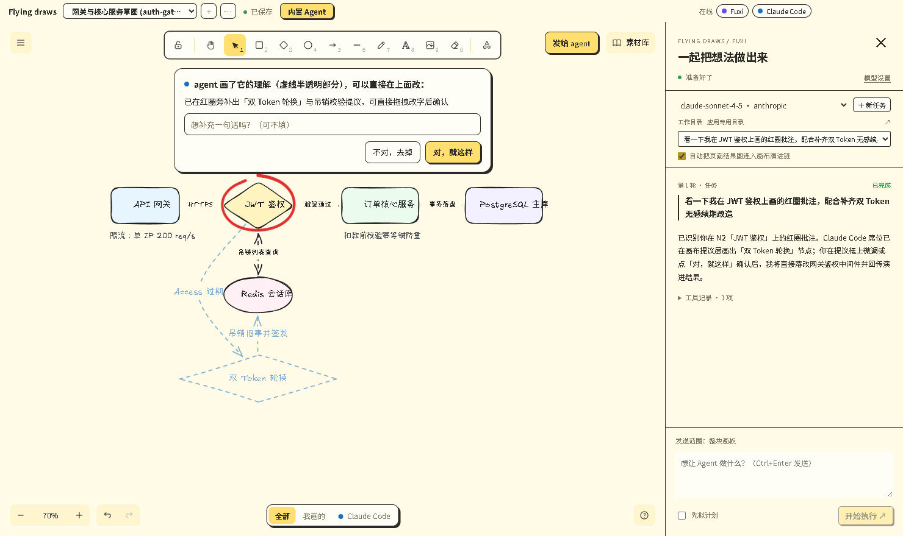
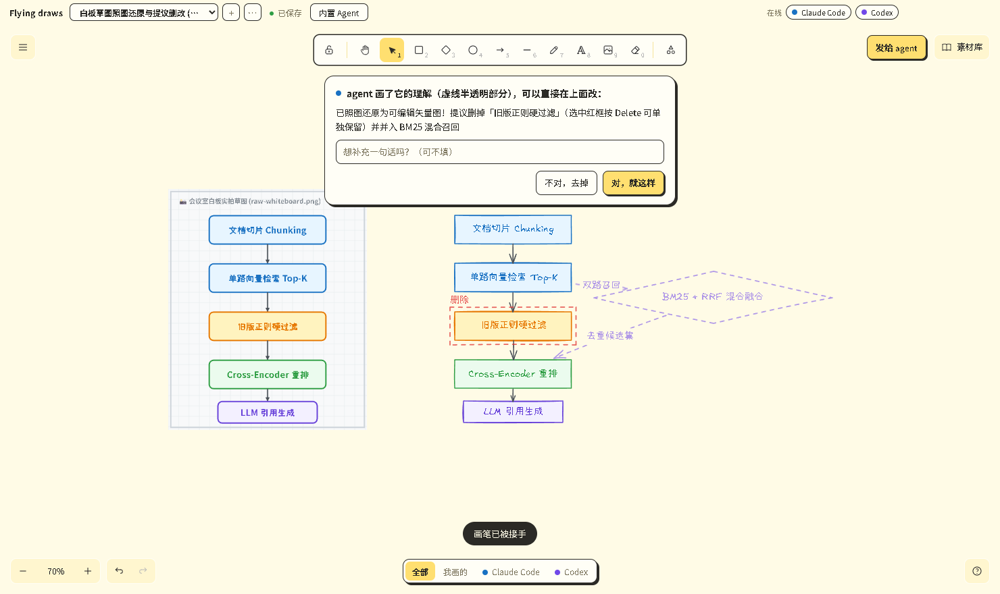

# Flying draws

**用画跟 Agent 对话的本地桌面画布与视觉工作台**  
*Draw to talk, edit proposals on canvas, and iterate visually with coding agents*

[](LICENSE)
[](package.json)
[](#10-个-mcp-画布工具)



有些想法打字解释太费劲——服务怎么连、状态怎么流转、页面哪一处要改，随手画个框、在截图上画个红圈就一目了然。**Flying draws** 把本地桌面画布（基于 Electron + Excalidraw 构建，内置离线手写中文字体）变成你和编码 Agent 共用的活草稿纸：Agent 不仅能读懂你画的拓扑结构与图片圈选，还能把它的理解先画在**半透明虚线提议层**上；你直接在画布上拖拽调整、双击改字再点确认，手改差异就会自动整理成反馈回传给它。

- **开箱即用双模式**：既可直接开启随包内置的 **Fuxi** 执行内核当作独立视觉编码工作台；也可通过标准 MCP 协议一键接入 **Claude Code、Codex、Cursor、Antigravity** 等外部客户端，支持多 Agent 同屏分席位接力。

---

## 为什么编码 Agent 需要一块「活」画布？

| 痛点维度 | 纯画图 MCP（单向吐图） | 浏览器一次性 DOM 点选 | **Flying draws** |
|---|---|---|---|
| **多轮修改上下文** | 每次重画覆盖，无历史对比 | 改完刷新即忘，看不见演进脉络 | **`v1 → v2 → v3` 视觉演进墙**，自动串联每轮渲染图与改动文件 |
| **人类纠偏方式** | 只能回到聊天框打字重说 | 只能重选重描述 | **提议层直接拖拽、改字、删单处红框**，手改差异自动编译成自然语言 Diff 回流 |
| **截图批注精度** | 缩放后坐标失真，模型瞎猜位置 | 仅限活 DOM，不支持设计稿/白板照 | **像素级逆映射**（兼容缩放/裁剪/翻转）+ **`trace_image` 照图还原可编辑矢量** |
| **多 Agent 协作** | 单会话独占 | 无空间共享 | **Win32 物理像素伴随吸附** + **6 色具名席位与 `canvas_pass` 递画笔接力** |

### 三大核心工作流实拍

#### 1. 页面圈改与多轮视觉演进墙（`v1 → v2 → v3`）

把网页截图或设计稿拖进画布，用红圈圈出问题、写一句批注——语义层自动将缩放、裁剪（`crop`）甚至翻转（`scale`）后的画布圈选**逆映射回原图真实像素坐标**，告别多模态模型瞎猜位置；Agent 改完源码重新渲染后，新版页面图自动落位在旧图右侧，并用标有本轮改动文件的连线串成 `v1 → v2 → v3` 演进链（同时严格隔离 `canvas_read` 自拍截图，杜绝画中画递归）。


#### 2. 白板草图照图还原 + 红框局部否决提议（`trace_image` + `Proposal Diff`）

拍一张白板草图或粘贴架构截图，通过 `trace_image` 一键还原为保留原图配色的可编辑矢量方框与绑定连线；Agent 发起改删时，新增内容以 **55% 半透明虚线提议**呈现，待删旧节点则套上 `#e03131` 红色「删除」预览框。无需打字来回拉扯——直接在提议上**拖拽位置、双击改字、选中不想要的单处红框按 `Delete` 单独保留原节点**，再点「**对，就这样**」，手改差异自动编译成自然语言反馈回传。



#### 3. 工作流状态机共绘 + 多 Agent 分席位接力（`Multi-Seat` + `canvas_pass`）

你随手画出正向主干工作流，**Claude Code**（蓝线）、**Codex**（紫线）与内置 **Fuxi** 各自以独立配色席位在同一张画板上补齐超时回滚与逆向退款分支，底部筛选栏可一键切换「全部 / 我画的 / 指定 Agent 席位」，并支持通过 `canvas_pass` 在不同编码 Agent 之间接力递交画笔与附言（同时支持将窗口往 IDE 侧边一靠实现 Win32 `DWMWA_EXTENDED_FRAME_BOUNDS` 跨 DPI 物理像素伴随吸附）。


---

## 快速上手

### 方式一：下载桌面版开箱即用（Windows x64）

前往 **[GitHub Releases](../../releases)** 下载最新的 `Flying-draws-win32-x64.zip`，解压后直接运行 `Flying draws.exe`：
- 已内置离线手写字体与经过 SHA-256 校验的 **Fuxi** 执行内核，点击标题栏 **「内置 Agent」** 配置模型服务后即可直接对话、改代码与上墙演进，无需安装 Node.js 或 Rust。

### 方式二：从源码运行 & 接入外部编码 Agent

环境要求：Node.js `>= 20.19`（或 `22.12+`）。Windows x64 下 `npm install` 会自动拉取并校验预编译 Fuxi 内核（无需 Rust 工具链；非 Windows 或离线环境自动跳过，外部 MCP 全部 10 个画布工具仍 100% 可用）。

#### 1. 安装与构建

```bash
npm install
npm run build
```

> - 国内网络下载 Electron 较慢时，可指定镜像加速：
>   `ELECTRON_MIRROR=https://npmmirror.com/mirrors/electron/ npm install`
> - 若首次离线安装跳过了内置内核，联网后执行 `npm run fetch:fuxi` 即可自动补装。

#### 2. 一键接入外部 MCP 客户端

运行内置向导输出你所用客户端（Claude Code / Cursor / Codex / Antigravity）的现成接入命令或 JSON 配置（自动填入本机绝对路径）：

```bash
# 查看全部主流客户端的一键接入命令
node out/bridge/index.js setup

# 或只输出指定客户端（支持 claude | cursor | codex | antigravity）
node out/bridge/index.js setup claude

# 自检 Node 版本、构建产物、桌面端寻址、本地服务与内置 Fuxi 内核状态
node out/bridge/index.js doctor
```

例如在 Claude Code 中一行完成注册：

```bash
claude mcp add --scope user flying-draws -- node "/你的绝对路径/out/bridge/index.js"
```

> 全局链接（`npm link`）后，也可直接使用 `flying-draws setup`、`flying-draws doctor` 与 `flying-draws-mcp`。连接后无需手动先开桌面端——当 Agent 首次调用 `canvas_open` 或 `canvas_read` 时，桥接进程会自动拉起画布窗口。

#### 3. 试玩示例画板

仓库自带了一份网关与核心服务草图 [`examples/architecture-sketch.excalidraw`](examples/architecture-sketch.excalidraw)：

```bash
# 在终端预览该画板的节点、连线与手绘结构
node scripts/inspect.mjs examples/architecture-sketch.excalidraw
```

把它复制到 `~/.flyingdraws/boards/arch.excalidraw`，对你的 Agent 说：
> *「用 `canvas_read` 看看 `arch` 画板上我红圈圈住的地方，然后用 `canvas_propose` 帮我把双 Token 刷新流程补上。」*

Agent 读到的不是杂乱的坐标 JSON，而是高信噪比的空间语义描述：

```text
画板「arch」v1：5 个节点，4 条连线，3 段文字，1 笔手绘
节点：
  N1 「API 网关」矩形
  N2 「JWT 鉴权」菱形
  N3 「订单核心服务」矩形
  N4 「PostgreSQL 主库」矩形
  N5 「Redis 会话库」椭圆
连线：
  N1「API 网关」 → N2「JWT 鉴权」，标着「HTTPS」
  N2「JWT 鉴权」 ↔ N5「Redis 会话库」，标着「吊销列表查询」
文字：
  T2 「这里补双 Token 无感续期！」（在 N2「JWT 鉴权」 上方）
手绘：
  S1 一个圈，圈住了 N2「JWT 鉴权」，在 N1「API 网关」 右侧
```

---

## 内置 Fuxi 独立 Agent 工作台

当你希望脱离外部终端、直接把画布当作**一体化本地视觉编码工作台**时，点击窗口顶部 **「内置 Agent」** 即可唤醒随附的 **Fuxi** 执行内核：

- **模型配置**：在面板「模型设置」填入服务地址、模型 ID 与密钥（原生支持 **OpenAI 兼容接口、Anthropic Messages、Gemini**；密钥仅存本机 `~/.flyingdraws/agent/config.toml` 或引用 `env:变量名`，绝不写入画板文件）。
- **画布选区直投**：选择目标项目目录后，框选画布元素时仅精准投递选区及重叠底图（自动附带像素级圈选坐标），未框选时投递当前画板全局语义；选中单张图片可直接点击 **「转成可编辑图 ↗」**。
- **自动演进上墙**：默认开启 **「自动把页面结果图连入画布演进链」**，工具产出的页面渲染截图会自动排布在上一版图片右侧并生成演进连线，也可随时点击 **「放到画布 ↗」** 幂等上墙，开启下一轮圈改。
- **自定义内核覆盖**：可通过环境变量 `FLYINGDRAWS_FUXI_BIN` 指向自定义兼容内核路径；宿主协议规范见 [`docs/fuxi-host-plan.md`](docs/fuxi-host-plan.md)。

---

## 10 个 MCP 画布工具

桥接器（`src/bridge/index.ts`）通过纯洁 `stdio` 暴露以下 10 个工具，读写工具均支持 `board` 指定画板与 `as` 声明协作者席位：

| 工具名 | 作用说明 |
|---|---|
| `canvas_open` | 打开画布窗口并置顶；传入不存在的 `board` 时自动创建空白画板并切换 |
| `canvas_list` | 列出所有画板（含当前激活状态、显示标题、版本号 `v*`、元素数量；带 `readOnlyHint`） |
| `canvas_rename` | 重命名画板 ID 或修改/清空显示标题，完整保留当前会话与撤销栈 |
| `canvas_delete` | 删除指定画板及磁盘文件（保留最后一块画板，删当前画板时自动回退） |
| `canvas_read` | 读取空间语义描述（`N*` 节点、`T*` 文字、`S*` 手绘/分组、`I*` 图片及像素级批注），可选结构 `format: "graph"` 与按需截图 `image: auto/always/never`，顺带取走用户收件箱与递画笔交接 |
| `canvas_request` | 在画布顶部弹出提示横幅请用户作画，立即返回 `request_id` |
| `canvas_wait` | 长轮询（单次最多 45s）等待 `canvas_request` / `canvas_propose` 的用户响应，或等待用户主动「发给 agent」及其他席位的递画笔交接 |
| `canvas_pass` | 将当前画板快照与交接附言递给另一席位（`to`），目标正在 `canvas_wait` 时即时唤醒，否则挂起待取 |
| `canvas_propose` | 在半透明虚线提议层新增元素、用虚线标记框预览改删操作并附上确认问题；用户手改或局部删框接受后，经 `canvas_wait` 返回自然语言 `changes` |
| `canvas_draw` | 立即执行整批新增（`add_node` / `add_edge` / `add_text`）、照图还原（`trace_image`）及改删/改样式（`update_node` / `delete_node` / `update_edge` / `delete_edge` / `update_text` / `delete_text` / `delete_strokes` / `set_style`）；引用已有元素需带 `base_version` |

---

## 核心工程架构导览

底层数据结构、并发算法与系统编程细节请参阅 **[架构与核心工程设计白皮书 (`docs/architecture.md`)](docs/architecture.md)**，演示复现流程请参阅 **[演示录制分镜手册 (`docs/demo-playbook.md`)](docs/demo-playbook.md)**：

1. **双向提议对齐协议（Proposal-Diff Protocol）**：`toProposalPlan` 破坏性操作延迟化预览框、`resolveProposal` 帧存活局部否决、以及 `diffProposal` 双阈值（`24px` 位移 / `25%` 缩放）去噪合成中文反馈。
2. **基于语义指纹的乐观并发控制（Semantic Rebase & Fingerprinting）**：60 版本滑动历史窗口、`rebaseOps` 阅读序漂移自动重编号、以及 `elementFingerprints` 拓扑签名豁免绑定箭头因拖动节点产生的派生 `version` 伪冲突。
3. **混合空间语义层与像素逆映射（Spatial Semantic & Pixel Back-Projection）**：两阶段并查集手写分组与标注圈预判防吞并、零依赖 PNG/GIF/WebP/JPEG/SVG 二进制头解析、裁剪/翻转仿射逆映射（`canvasRectToImagePixels`）与 `lineage` 防递归演进排版。
4. **Win32 物理像素伴随吸附引擎（DWM Frame-Aligned Docking）**：`koffi` 直调 `user32`/`dwmapi`、`SetWinEventHook` 跨进程跟随、跨 DPI 显示器隐形阴影边（`DWMWA_EXTENDED_FRAME_BOUNDS`）二次校准与后台零开销休眠。
5. **双通道隔离与本地安全模型**：`127.0.0.1` + 禁 `Origin` + `Host` 校验防 DNS Rebinding + 常量时间随机 Token、单路径串行原子写，以及内置 Fuxi NDJSON 宿主进程双通道隔离。

---

## 常用脚本与目录结构

| 命令 | 说明 |
|---|---|
| `npm run dev` | 开发模式热重载启动画布桌面端 |
| `npm run build` | 构建 Electron 应用到 `out/`，并编译 MCP 桥接到 `out/bridge/` |
| `npm run build:bridge` | 仅编译 MCP 桥接与 CLI（`out/bridge/index.js`） |
| `npm run fetch:fuxi` | 拉取并按 SHA-256 校验预编译 Fuxi 内核到 `resources/fuxi/` |
| `npm run build:fuxi` | 维护者从本地 Fuxi Rust 源码编译内核（`-- --source <path>`） |
| `npm start` | 预览运行已构建的应用 |
| `npm run typecheck` | 全量 TypeScript 类型检查 |
| `npm test` | 运行语义层、排版、Diff、演进墙、CLI 与内核拉取单元测试 |
| `npm run inspect` | 解析并打印 `.excalidraw` 画板结构 |
| `npm run package:desktop` | 打包包含内置 Fuxi 内核的完整 Windows 独立目录包（`dist/Flying-draws-win32-x64`） |
| `npm run package:canvas` | 打包免 Fuxi 的纯 MCP 画布轻量 Windows 目录包（可通过 `FLYINGDRAWS_APP` 指定） |
| `npm run e2e:draw` | 拉起隔离实例（`FLYINGDRAWS_HOME`）运行多画板、绘制与提议端到端测试 |
| `npm run e2e:agent` | 使用隔离目录与本机假供应商验证内置 Fuxi Agent 全链路 |

```text
src/bridge/     MCP 桥接器与零门槛 CLI（setup / doctor / 自动寻址拉起）
src/main/       主进程：多画板会话、本地安全服务、空间语义层、排版与提议 Diff、演进墙、Win32 吸附、Fuxi 宿主客户端
src/preload/    ContextIsolation 最小白名单桥接接口
src/renderer/   Excalidraw 画布、请求/提议横幅、动态席位筛选栏、内置 Agent 面板
src/shared/     主进程与渲染层共享的 Agent 状态、血缘元数据与工具展示定义
examples/       开箱体验用的标准 Excalidraw 示例画板
docs/           架构白皮书（architecture.md）、录制手册（demo-playbook.md）、宿主契约（fuxi-host-plan.md）等文档
scripts/        字体同步、预编译内核拉取校验、画板检查、桌面打包与端到端测试脚本
test/           纯函数与 CLI 自动化测试集
```

---

## 安全与隐私说明

- **纯本地画布服务**：HTTP Daemon 仅监听 `127.0.0.1`，凭证写入本机 `~/.flyingdraws/daemon.json`（`0600`），严拒浏览器 `Origin` 请求与非 `127.0.0.1` 的 `Host` 头（防御 DNS Rebinding）。
- **数据流透明**：画板文件默认保存在本机 `~/.flyingdraws/boards/*.excalidraw`，字体完全本地化断网可用；仅当你通过外部 Agent 读取截图或在内置 Agent 中发起任务时，画布摘要/截图才会发往你自行配置的模型服务商。

## 致谢与许可证

- 画布底层交互组件基于开源项目 [`@excalidraw/excalidraw`](https://github.com/excalidraw/excalidraw)（MIT License）构建；Flying draws 为独立开源项目，与 Excalidraw 官方无隶属或背书关系。
- 随附预编译 **Fuxi** 执行内核采用 MIT License 分发（`resources/fuxi/LICENSE`）；随包第三方运行时库、字体资产与 Rust 内核依赖的完整版权声明及许可证文本见 [THIRD_PARTY_NOTICES.md](THIRD_PARTY_NOTICES.md)。
- 特别鸣谢首席驻场监工 **哈吉米**——在多轮并发压测、像素逆映射校准与深夜重构期间提供了稳定的呼噜声算力与精神监理（尽管当事人至今坚称自己只是顺路过来看看）。
- 本项目采用 [MIT License](LICENSE) 开源（Copyright (c) 2026 Bofei Jian）。
