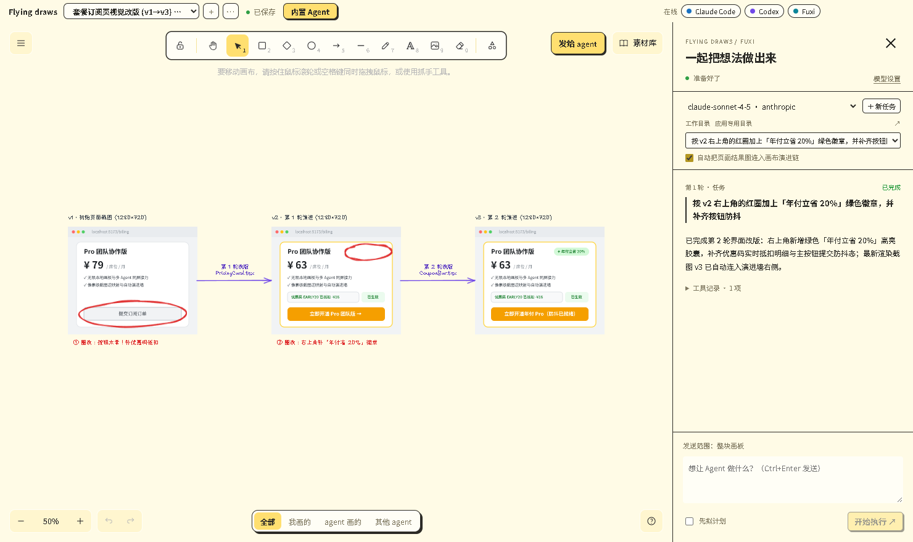
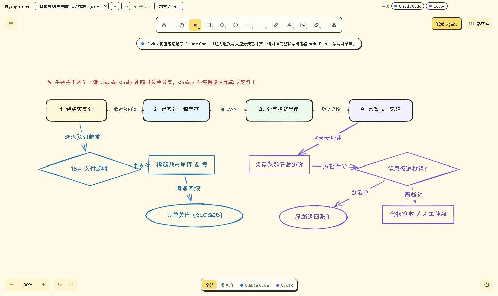

# Flying draws

在画布上圈出要改的地方，让 Agent 去改代码，改完的结果回到同一张画布上，你接着圈下一处。

[](LICENSE)
[](package.json)


Flying draws 是一个本地桌面画布，基于 Electron 和 Excalidraw，中文手写字体随包带着，断网也能画。它有两种用法：

- **自带 Agent**：点标题栏的「内置 Agent」，用随包的 Fuxi 内核直接改你的项目。截图、批注、每一版的结果和改动记录都留在画布上，做第二轮、第三轮时不用把背景再讲一遍。
- **给别的 Agent 当画布**：通过 MCP 接入 Claude Code、Codex、Cursor、Antigravity 等客户端。Agent 能读懂你画的框、线和圈，也能把它的想法先画成提议，等你确认。

目前是早期版本，只在 Windows x64 上测过。

## 用内置 Agent 改页面，一轮是怎么走的

1. 把页面截图拖进画布，在要改的地方画个圈，旁边写一句要求，比如「血条放大 1.5 倍，数字加粗」。
2. 选中这些内容，在右侧面板写下目标，按 `Ctrl+Enter` 发出。Agent 收到的是截图，以及圈选位置在原图上的像素坐标（画布缩放、裁剪、翻转过也照样换算）。
3. Agent 在你选的项目目录里找到对应代码、改掉，再打开页面重新截图。
4. 改后的截图自动放在原图右边，你圈过的位置用虚线框标在新图上，两张图并排就能看出改得对不对。
5. 看完点「改对了」或「没改对」。说没改对时可以写一句原因，下一轮会带上这句话。
6. 面板里的「本轮改动」列出这一轮改了哪些文件，点开就是差异。开始前工作区已经有的未提交改动不算在里面，Agent 用命令改的文件也会算上。

每一轮的结果图按 `v1 → v2 → v3` 横着排下去，连线上写着那一轮改了哪些文件。



几个和日常使用有关的细节：

- **审批**：默认按风险询问。只读命令、这一轮自己起的预览服务和关掉它，会自动放行，不再逐个弹窗。其余的审批卡可以选「本任务内都允许」，同一任务里参数完全相同的调用之后直接放行，面板上可以一键清空。面板上的 YOLO 开关可以让所有工具调用都不再确认，只在这次打开应用期间有效，重启后恢复询问。
- **先拟计划**：默认不勾，发出后直接执行。勾上后 Agent 先写计划，你确认了再执行。
- **后台运行**：关掉窗口只是藏到托盘，任务照常进行。需要你确认时托盘会提醒。
- **转成可编辑图**：选中一张图片（比如白板照片或架构截图），点「转成可编辑图」，Agent 会把它还原成可以直接拖动、改字的方框和连线。
- **模型**：支持 OpenAI 兼容接口、Anthropic Messages 和 Gemini 三种协议。「模型设置」默认是 DeepSeek 的 `deepseek-flash` 预设（已实测，支持看图），只需填密钥；换成「自定义」可以填别的服务地址和模型名，模型支持图片输入时记得勾上「该模型支持图片输入」，否则只发送画布结构、不发截图。

## 给外部 Agent 用：MCP 画布

接上以后，Agent 调用 `canvas_read` 得到的是一段描述，不是一堆坐标。拿仓库里的示例画板 [`examples/architecture-sketch.excalidraw`](examples/architecture-sketch.excalidraw) 来说，Agent 读到的是：

```text
画板「arch」v1：5 个节点，4 条连线，3 段文字，1 笔手绘
节点：
  N1 「API 网关」矩形
  N2 「JWT 鉴权」菱形
  N3 「订单核心服务」矩形
  N4 「PostgreSQL 主库」矩形
  N5 「Redis 会话库」椭圆
连线：
  N1「API 网关」 → N2「JWT 鉴权」，标着「HTTPS」
  N2「JWT 鉴权」 → N3「订单核心服务」，标着「验签通过」
  N2「JWT 鉴权」 ↔ N5「Redis 会话库」，标着「吊销列表查询」
  N3「订单核心服务」 → N4「PostgreSQL 主库」，标着「事务落盘」
文字：
  T1 「限流：单 IP 200 req/s」（在 N1「API 网关」 下方）
  T2 「这里补双 Token 无感续期！」（在 N2「JWT 鉴权」 上方）
  T3 「扣款前校验幂等键防重」（在 N3「订单核心服务」 下方）
手绘：
  S1 一个圈，圈住了 N2「JWT 鉴权」，在 N1「API 网关」 右侧
```

光看文字认不出来的内容（比如手写字），会附上截图。

Agent 想改画布时，可以先用 `canvas_propose` 把改动画成半透明的虚线提议，要删的元素套上红框。你可以直接在画布上拖位置、改字，或者删掉某一处不想要的改动，然后点确认。你手动调整过的地方会整理成一段文字反馈给 Agent。


几个 Agent 可以同时画在一张画板上，各自用不同颜色。画布底部能按作者筛选，`canvas_pass` 可以把画笔连同一句附言交给另一个 Agent。在画布上点「发给 agent」（`Ctrl+Shift+Enter`）可以把画好的内容发给指定的 Agent；对方没在等的话，会把一句取画指令放进剪贴板，你粘贴给它就行。



### 10 个画布工具

读写类工具都可以用 `board` 指定画板，用 `as` 声明自己的席位名。

| 工具 | 作用 |
|---|---|
| `canvas_open` | 打开画布窗口；画板不存在时新建 |
| `canvas_list` | 列出所有画板，带版本号和元素数量 |
| `canvas_rename` | 改画板名或显示标题 |
| `canvas_delete` | 删除画板（至少保留一块） |
| `canvas_read` | 读画板描述，可选结构化格式和截图；顺带取走用户发来的画和别人递来的画笔 |
| `canvas_request` | 在画布顶部弹出横幅，请用户画点什么 |
| `canvas_wait` | 等用户的回应、用户主动发来的画，或别的席位递来的画笔（单次最多 45 秒） |
| `canvas_pass` | 把画板和附言递给另一个席位 |
| `canvas_propose` | 画出待确认的提议，用户确认后通过 `canvas_wait` 拿到结果和手改说明 |
| `canvas_draw` | 直接新增、修改、删除节点、连线和文字，或把图片还原成可编辑图 |

## 安装和运行

### 下载桌面版（Windows x64）

到 [Releases](https://github.com/jian-in/Flying-draws/releases/latest) 下载 `Flying-draws-win32-x64.zip`，解压到任意目录，运行里面的 `Flying draws.exe`。包里已带 Electron 和 Fuxi 内核，不用装 Node.js。

- exe 没有代码签名，第一次运行时 Windows 可能提示「Windows 已保护你的电脑」，点「更多信息」→「仍要运行」。
- 内置 Agent 用 git 记录每一轮的改动；没装 git 的话，改动只能按工具记录粗略统计。
- 接入外部 Agent 时仍需要本机装 Node.js，见下面的[接入外部 Agent](#接入外部-agent)。

### 从源码运行

需要：

- Windows x64（内置 Agent 的内核只有这个平台的预编译版本；只用 MCP 画布不受这个限制，但其他平台没有测过）
- Node.js 20.19 或更高
- git（用来记录每一轮的改动；没装的话，改动只能按工具记录粗略统计）

```bash
npm install
npm run build
npm start
```

`npm install` 会顺便从本仓库的 Release 下载 Fuxi 内核，并校验 SHA-256。如果当时没网跳过了，联网后执行 `npm run fetch:fuxi` 补上。国内下载 Electron 慢的话，可以在安装前设置镜像：

```bash
ELECTRON_MIRROR=https://npmmirror.com/mirrors/electron/ npm install
```

想要一个能单独运行的目录包，执行 `npm run package:desktop`，产物在 `dist/Flying-draws-win32-x64/`。不需要内置 Agent 的话，用 `npm run package:canvas` 打一个只有画布的包。

### 接入外部 Agent

MCP 桥接是一个 Node 脚本，需要本机装 Node.js 20.19 或更高。运行向导，它会打印各个客户端的接入命令，路径已经替你填好：

```bash
# 从源码运行：先构建，再在仓库根目录执行
node out/bridge/index.js setup

# 用下载的桌面版：桥接在解压目录里，会自动找到同一个包里的 Flying draws.exe
node "<解压目录>\resources\app\out\bridge\index.js" setup
```

下面的命令都以源码目录为例，用桌面版时把 `out/bridge/index.js` 换成解压目录里的那个路径。

只看某一个客户端（`claude`、`cursor`、`codex`、`antigravity`）：

```bash
node out/bridge/index.js setup claude
```

以 Claude Code 为例，注册命令长这样：

```bash
claude mcp add --scope user flying-draws -- node "/你的路径/out/bridge/index.js"
```

不用先手动打开画布，Agent 第一次调用 `canvas_open` 或 `canvas_read` 时会自动把窗口拉起来。接不上时运行 `node out/bridge/index.js doctor` 自检，它会检查 Node 版本、构建产物、桌面端位置、本地服务和内核。

有些客户端的会话挂不上 MCP（比如嵌在别的应用里的聊天会话），但能跑终端命令。这时可以用 `call` 直接调用画布工具，参数是一个 JSON 对象，也可以写在文件里用 `@文件名` 传，`--as` 指定席位：

```bash
node out/bridge/index.js call canvas_wait '{"board":"default","timeout_s":40}' --as 后端
node out/bridge/index.js call canvas_draw @ops.json --as 后端
node out/bridge/index.js call --list
```

它和 MCP 模式用的是同一套工具，结果打印到终端，截图存成临时文件并打印路径。设了 `FLYINGDRAWS_HOME` 时会先提示连的是哪个数据目录，免得连到另一个画布实例上。

想试试示例画板，把 `examples/architecture-sketch.excalidraw` 复制成 `~/.flyingdraws/boards/arch.excalidraw`，然后对 Agent 说：「用 canvas_read 看看 arch 画板上我圈的地方，再用 canvas_propose 把双 Token 刷新流程补上。」

## 数据存在哪，会发到哪

所有数据都在本机的 `~/.flyingdraws/` 下（可以用环境变量 `FLYINGDRAWS_HOME` 换位置）：

| 内容 | 位置 |
|---|---|
| 画板 | `boards/*.excalidraw` |
| 模型配置和密钥 | `agent/config.toml`（密钥也可以写成 `env:环境变量名`，不存明文） |
| 任务记录和结果截图 | `agent/` |
| 每轮改动的快照 | `agent/baselines/` |

改动快照存在这个目录里，不会往你的项目写东西：你项目的索引、提交和 `.git` 目录都不会被改动。每个项目只保留最近 50 轮的差异，更早的只留文件列表，旧快照会自动清理。工作目录不是 git 仓库时，`node_modules`、`dist` 这类目录不计入，文件超过 2 万个或总量超过 1 GB 的文件夹不拍快照。

画布和外部 Agent 之间走的是本机服务：只监听 `127.0.0.1`，要带随机令牌，拒绝浏览器发来的请求。

会发出去的只有一种情况：你在内置 Agent 里发起任务，或者外部 Agent 读取画布时，画板描述和截图会发给你自己配置的模型服务商。Agent 执行命令、改文件都在本机。

## 开发

| 命令 | 说明 |
|---|---|
| `npm run dev` | 开发模式，热重载 |
| `npm run build` | 构建应用到 `out/`，同时编译 MCP 桥接 |
| `npm start` | 运行构建好的应用 |
| `npm run typecheck` | 类型检查 |
| `npm test` | 单元测试 |
| `npm run test:fast` | 快速单元测试（跳过耗时的基线和 CLI 测试） |
| `npm run e2e:draw` | 在隔离实例里跑画板、绘制和提议的端到端测试 |
| `npm run e2e:agent` | 用本机的假模型服务跑内置 Agent 的端到端测试，不调用真实模型 |
| `npm run inspect -- <文件>` | 打印一个 `.excalidraw` 文件的结构 |
| `npm run fetch:fuxi` | 下载并校验预编译的 Fuxi 内核 |

```text
src/bridge/     MCP 桥接和命令行（setup、doctor、call）
src/main/       主进程：画板、本机服务、画布语义、提议比对、内置 Agent、改动快照、窗口吸附
src/preload/    暴露给页面的接口
src/renderer/   画布界面和内置 Agent 面板
src/shared/     主进程和页面共用的类型
test/           单元测试
scripts/        内核下载、打包、端到端测试等脚本
```

提议怎么比对用户的手改、并发写入怎么避免冲突、截图圈选怎么换算回原图像素、窗口怎么贴在 IDE 旁边，这些设计写在 [docs/architecture.md](docs/architecture.md)。内置内核和宿主之间的协议见 [docs/fuxi-host-plan.md](docs/fuxi-host-plan.md)。

## 许可

本项目采用 [Apache License 2.0](LICENSE)，署名见 [NOTICE](NOTICE)，随包依赖和字体的许可见 [THIRD_PARTY_NOTICES.md](THIRD_PARTY_NOTICES.md)。

画布组件基于 [Excalidraw](https://github.com/excalidraw/excalidraw)（MIT）。Flying draws 是独立项目，和 Excalidraw 官方没有关系。
