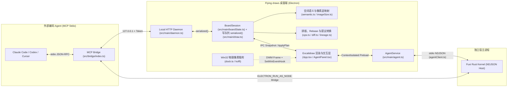
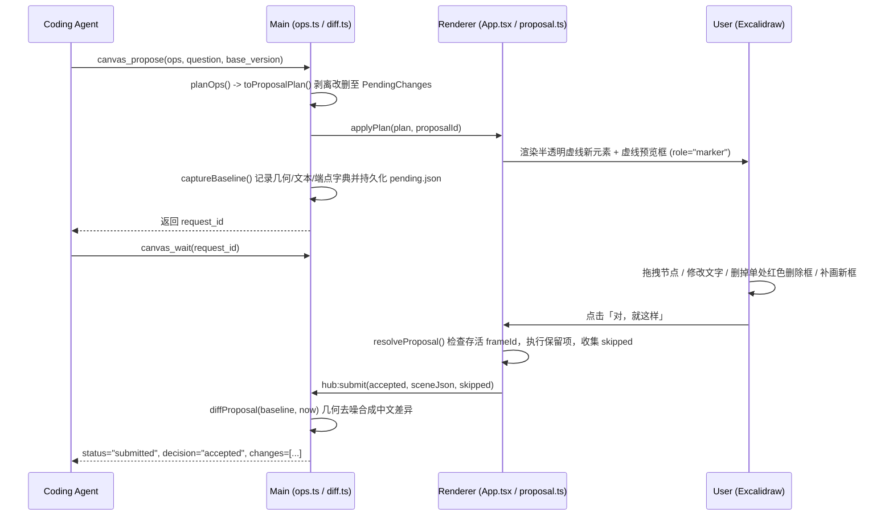
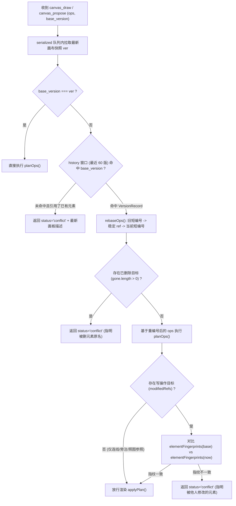

# Flying draws 架构与核心工程设计

本文档面向深入理解 **Flying draws** 底层机制的开发者与架构审阅者，结合仓库真实源码拆解项目的整体拓扑与五大核心工程设计。

---

## 全局系统拓扑

Flying draws 同时支撑两条工作流：**外部编码 Agent 的零配置 MCP 空间外设**（Claude Code、Codex、Cursor、Antigravity 等通过 `out/bridge/index.js` 接入），以及**内置 Fuxi 内核的一体化视觉工作台**。两条路径在主进程汇聚到同一套画板会话、乐观并发控制与语义排版引擎上。

### 核心模块速查表

| 模块路径 | 工程职责 | 依赖特征 |
|---|---|---|
| `src/bridge/index.ts` | 10 个 MCP 画布工具注册、席位心跳上报、`setup`/`doctor`/`call` CLI、多路径桌面端自动拉起 | Node.js 标准库 + MCP SDK |
| `src/main/ops.ts` | 指令校验、Dagre 自动排版、梁-巴斯基（Liang–Barsky）连线避障、`trace_image` 比例映射、`rebaseOps` 重编号、`elementFingerprints` 指纹、`toProposalPlan` 预览框转换 | 纯函数（仅依赖 `@dagrejs/dagre`） |
| `src/main/semantic.ts` | 阅读序短编号生成、两阶段并查集手绘聚类与标注圈预判、旁注吸附、裁剪/翻转原图像素逆映射（`canvasRectToImagePixels`） | 纯函数，零外部依赖 |
| `src/main/imageSize.ts` | PNG / GIF / WebP（VP8/VP8L/VP8X）/ JPEG / SVG 二进制头部零依赖像素尺寸解析 | 纯函数，零外部依赖 |
| `src/main/diff.ts` | `captureBaseline` 提议底稿快照、`diffProposal` 几何去噪与中文自然语言差异合成 | 纯函数，零外部依赖 |
| `src/main/lineage.ts` | `shouldAutoPlaceResultImage` 画布自拍防递归过滤、`planImageLineage` 多轮 `v1 → v2 → v3` 演进墙横向落位与绑定连线规划 | 纯函数，零外部依赖 |
| `src/main/dock.ts` & `dockGeometry.ts` | `koffi` Win32/DWM FFI、`SetWinEventHook` 跨进程窗口跟随、`DWMWA_EXTENDED_FRAME_BOUNDS` 跨 DPI 隐形边框二次校准 | 主进程（Windows 原生 API） |
| `src/main/daemon.ts` & `atomicWrite.ts` | `127.0.0.1` 防重绑定 HTTP 服务、常量时间 Token 鉴权、单文件路径串行队列原子写 | Node.js 标准库 |
| `src/main/agentClient.ts` & `agent.ts` | 内置 Fuxi 子进程 NDJSON 协议栈、双阶段请求结算、执行与审批通道分离、会话/血缘持久化 | Node.js 标准库 |

---

## 一、双向提议对齐协议（Proposal-Diff Protocol）

**涉及源码**：`src/main/ops.ts`、`src/renderer/src/canvas/proposal.ts`、`src/renderer/src/App.tsx`、`src/main/diff.ts`、`src/main/pending.ts`

### 1. 设计动机
普通画图 MCP 工具只有单向输出（Agent 直接覆写画布），一旦理解偏差就会破坏用户手绘草图；而退回聊天框用文字逐条请示又割裂了空间直觉。Flying draws 设计了类 Git PR Review 的**画布原位提议与手改回流协议**：Agent 把新增与改删意图以「半透明可交互草稿」投射到画布，用户可以直接在提议上拖拽、改字、局部剔除单条修改，画布在确认瞬间自动把人类手改行为编译回自然语言 Diff。

### 2. 三阶段核心机制

1. **破坏性操作延迟化与预览标记框（`toProposalPlan`）**
   - `canvas_propose` 与 `canvas_draw` 共享同一套 `planOps()` 校验与排版管线。当进入提议模式时，`toProposalPlan()` 将 `updates`、`textEdits`、`styles`、`deletes` 全部拦截并转存进 `PendingChanges`（随 `~/.flyingdraws/pending.json` v2 格式原子落盘，跨重启不丢）。
   - 针对每一组被改删的目标元素 `targetGroups`（例如一组多笔手写字共用一个分组），计算联合包围盒并外扩 `MARKER_PAD = 10px`，生成虚线矩形预览框 `PlannedMarker` 与顶部 `-26px` 处的中文意图说明（删除框为 `#e03131` 红色、其余改动为席位色，透明度 `75%`，成组 ID `fd_mk_<frameId>`，标记 `customData.flyingdraws.role = 'marker'`）。
   - 新增元素打上 `layer: 'proposal'`（`55%` 透明度 + 虚线；若来自 `trace_image` 则保留原图配色与 `traced: true` 标记）。语义层 `buildGraph()` 通过 `!isMarker(el)` 过滤全部预览框，确保未决标记框绝不污染后续图结构。

2. **细粒度局部否决（`resolveProposal`）**
   - 用户审阅提议时，如果同意整体方案但反感其中某一处删除或改名，只需直接在画布上选中并按 `Delete` 删掉那一个预览框。
   - 点击「对，就这样」时，`src/renderer/src/canvas/proposal.ts` 中的 `resolveProposal()` 扫描当前未删除元素集合 `liveIds`：仅当 `liveIds.has(m.frameId)` 成立时才将其 `m.targets` 纳入 `approvedTargets` 交由 `applyChanges()` 落地；被用户手动删掉的标记框则自动转化为 `"不同意" + m.summary`（如 `不同意删除节点「登录」`），随后统一清理剩余标记框并将提议层新元素转正为 `layer: 'final'`（恢复 100% 不透明度与实线，同时保留 `trace_image` 原有的虚线属性）。

3. **抗手抖几何去噪与语义 Diff 合成（`captureBaseline` & `diffProposal`）**
   - 提议落盘瞬间，`captureBaseline()` 提取提议元素的初始快照 `ProposalBaseline`，不仅记录 `(x, y, w, h, label, from, to)`，还提前把连线两端关联元素的可读名称缓存在 `names: Record<string, string>` 字典中（即使确认前用户把连线指向的旧节点删了，Diff 依然能准确说出「把连线『网关』→『鉴权』改成了…」），同时拍下全画布 `elementIds` 快照。
   - 确认时，`diffProposal()` 对比当前画布与底稿，内置两道抗噪阈值：
     - **位移阈值 `MOVE_THRESHOLD = 24`（px）**：按元素中心点欧氏距离 `Math.hypot(dx, dy) >= 24` 判定有效挪动并推导中文方向（如 `往右下挪了`），过滤鼠标点击选中时的微米级手抖；
     - **缩放阈值 `RESIZE_THRESHOLD = 0.25`（25%）**：宽高相对变化率达 25% 才报告 `改了节点…的大小`；
     - **因果去重**：若连线断开是因为端点节点本身被用户删除，`rewired` 检查 `!byId.has(before)` 自动抑制冗余断连播报；同时扫描不在初始 `elementIds` 内且 `author !== 'agent'` 的元素，汇总用户顺手补画的节点、文字、连线与涂鸦，最终拼成高信噪比中文修订列表回传 Agent。

---

## 二、基于语义指纹的乐观并发控制（Semantic Rebase & Fingerprinting）

**涉及源码**：`src/main/boardState.ts`（`VersionRecord`）、`src/main/draw.ts`（`remember`、`drawOps`）、`src/main/ops.ts`（`rebaseOps`、`elementFingerprints`）

### 1. 工程痛点：短编号漂移与 Excalidraw 派生版本膨胀
直接让大模型读写 Excalidraw 的 21 位随机 ID 极易产生拼写幻觉，因此语义层按阅读顺序（`readingOrder`：行高容差 `40px` 分行后从左到右）实时编号为 `N1, N2 / T1 / S1 / I1`。这带来两个棘手的并发挑战：
1. **阅读序编号漂移**：Agent 基于 `v5` 准备修改 `N2`，但用户在 Agent 思考期间在画布左上角随手补了一个框升到 `v6`，原来的 `N2` 此刻变成了 `N3`；
2. **绑定箭头伪冲突陷阱**：用户在画布上只是把无关节点或目标节点稍微拖开了一点位置，Excalidraw 引擎会自动重算所有绑定在该节点上的 `arrow` 端点坐标与绑定文字位置，连带把这些箭头的 `element.version` 全部递增——如果直接用 `element.version` 做乐观锁，任何拖动都会导致连线操作大面积误报冲突。

### 2. 滑动版本窗口、Rebase 与语义指纹

- **内存版本窗口（`VersionRecord`）**：每次主进程通过 `describe()` 生成画板描述时，`remember()` 在当前 `BoardSession.history`（LRU 滑动窗口 `HISTORY_LIMIT = 60`）存入 `{ nodes, fingerprints }`。其中手绘笔画组 `strokeGroups` 绑定首笔 `g.refs[0]`，只要首笔仍在，即便组内序号重排也能精确追踪。
- **自动重编号（`rebaseOps`）**：当 `base_version !== ver` 时，`rebaseOps()` 将指令中的旧短编号（含 `N* / T* / S* / I*`）经历史表反映射回底层稳定 `ref`，再投射到当前最新 `SemanticGraph` 的新短编号；通过稳定元素 ID 直接引用的图片（如内置面板发起的 `trace_image`）走 `stableRefs` 通道，天然免疫版本漂移。
- **读写分离锁粒度**：`DrawPlan` 严格区分 `existingRefs`（只读锚点，如向已有节点连一条新边 `add_edge`、挂一段 `add_text`、或 `trace_image` 对照原图）与 `modifiedRefs`（写目标：`update_* / delete_* / set_style`）。只读锚点只要元素未删即无锁放行；仅 `modifiedRefs` 进入指纹比对。
- **绑定箭头语义指纹（`elementFingerprints`）**：
  - 对节点、独立文字、手绘与未绑定箭头，指纹取 `${el.version ?? 0}:${boundText?.version ?? ''}`；
  - 对存在 `startBinding` 或 `endBinding` 的绑定箭头，抛弃易受端点牵连的 `el.version`，改用**拓扑与样式不变量**构造指纹：
    `bound-arrow | startElementId | endElementId | startArrowhead | endArrowhead | points.length | freeStart | freeEnd | strokeColor | strokeStyle | strokeWidth | opacity | layer | labelText+color+fontSize`
  - 由此，用户拖拽节点引发的箭头随动拉伸不会误判连线冲突，而真正修改连线标签、增删折点、改色或重绑端点则 100% 精准拦截。

---

## 三、混合空间语义层与像素逆映射（Spatial Semantic & Pixel Back-Projection）

**涉及源码**：`src/main/semantic.ts`、`src/main/imageSize.ts`、`src/main/ops.ts`、`src/main/lineage.ts`

### 1. 两阶段手绘聚类与「标注圈预判」防吞并
用户在画布上手写批注并用红圈圈起来时，朴素的距离或包围盒聚类会把外围红圈和内部手写字合并成同一个「涂鸦团」，丢失「圈选」这一核心交互语义。`semantic.ts` 采用两阶段几何分析解决该问题：
- **负向采样点外接框修正（`bboxOf`）**：Excalidraw 的 `freedraw / line / arrow` 以落笔点为 `(x, y)`，用户往左或往上运笔时 `points` 为负值而 `width/height` 仍存正数。`bboxOf()` 直接扫描全体 `points` 极值重建真实物理包络。
- **阶段一：标注圈预判冻结（`isAnnotationLoop`）**：先用首尾距离 `< 0.2 * diag`（且对角线 `diag >= 24`）识别闭合圈 `loop`；若该闭合圈包含了任意节点、独立文字、图片，或包含了尺寸更小的其他笔画（`other.diag < s.diag * 0.85`），即判定为**标注圈**并从后续并查集中隔离。同时在并查集合并时拦截 `diag >= 60` 且尺寸比超过 `2.5x` 的大小笔画粘连。
- **阶段二：自适应采样并查集聚类**：对非标注圈笔画，每笔均匀抽取最多 `GROUP_SAMPLE_POINTS = 24` 个点（用点距代替外接框重叠），按自适应阈值 `gap = clamp(min(diag_i, diag_j), 30, 150)` 合并邻近笔画为手写组 `S1..Sk`，随后再让单笔标注圈统一结算 `encloses`，稳定输出「`S2 一个圈，圈住了 S1（一组手写，5 笔）`」。

### 2. 零依赖二进制图像头解析与裁剪/翻转逆映射
当用户把 2560×1440 的网页截图拖进画布缩放到 640×360、甚至裁剪（`crop`）或镜像翻转（`scale`）后在上面画红圈时，直接给大模型传画布坐标会导致严重定位偏移。
- **零依赖图像头解析（`src/main/imageSize.ts`）**：不引入 `sharp` 等原生编译包，直接按字节解析 PNG（`IHDR` chunk 偏移 16..24 大端宽高）、GIF87a/89a、WebP（覆盖 `VP8 ` 有损关键帧帧头、`VP8L` 14-bit 位打包与 `VP8X` 24-bit 扩展块）、JPEG（流式扫描 `0xFF` 段直至 `SOF0..SOF15`，对 Base64 DataURL 仅截取前 96KB 切片解码，PNG/WebP 仅取前 128 字符）及 SVG `width/height/viewBox`，零开销获取原图 `naturalSize`。
- **仿射逆映射（`canvasRectToImagePixels` & `canvasPointToImagePixels`）**：
  1. 求画布批注框（红圈、矩形框、箭头尖端、图上文字或手写组）与画布图片框 `imgBbox` 的交集，计算归一化UV比例 $u \in [0, 1], v \in [0, 1]$；
  2. 若图片存在水平或垂直翻转（`scale[0] < 0` 或 `scale[1] < 0`），执行镜像反演 $[u_0, u_1] \leftarrow [1 - u_1, 1 - u_0]$；
  3. 投射到裁剪源矩形 `src`（若开启裁剪则为 `el.crop`，否则为 `0, 0, naturalWidth, naturalHeight`），输出精准到原图像素的 `pixelBbox` 与 `pixelPoint`（`ImageRegionAnnotation`）。
- **正向比例还原（`trace_image`）**：反向同理，Agent 只需在原图像素坐标系 `space: { w, h }` 下描述看到的 `box / text / line`，`planTrace()` 自动按 `sx = box.w / space.w, sy = box.h / space.h` 缩放坐标与字号，默认通过 `placeBlock` 摆在原图右侧空位并保留原图十六进制配色。

### 3. 多轮视觉演进墙与防递归上墙（`src/main/lineage.ts`）
- **防画中画死循环（`shouldAutoPlaceResultImage`）**：内置 Agent 既会调用 `render_page` / `browser_page` 产出网页渲染截图，也会调用 `canvas_read` 获取画布自身截图。`shouldAutoPlaceResultImage()` 根据工具名与 `toolLabels` 映射严格剔除 `canvas_read` / `canvas_list` 等画布自省工具，确保只有外部页面/产物截图才会触发自动上墙。
- **演进树自动排版（`planImageLineage`）**：
  - **幂等防重**：检查画布存活元素中是否已有 `customData.flyingdraws.result === image.id`，确保自动上墙与手动点击「`放到画布 ↗`」零重复插入；
  - **血缘寻址与横向生长**：优先匹配本轮圈选原图的稳定 ID `sourceImageRef`，其次回溯同一 `workItemId` 下最近一轮（`round < current`）的结果图作为父锚点；新图自动落位在父图右侧 `parent.x + parent.w + 160`（遇障碍自动向右步进或换行）；
  - **改动证据链与作者筛选兼容**：同步生成绑定父子图片的 Excalidraw 箭头（标签自动提取本轮 `write_file / edit_file / apply_patch` 涉及的最多 4 个短文件名，如 `第 2 轮 · App.tsx, styles.css`）及图片顶部题注（如 `v2 · 1280×720`），统一打上 `author: 'agent', agent: AGENT_SEAT, seat: true, layer: 'final'`，与底部作者筛选器 100% 兼容。

---

## 四、Win32 物理像素伴随吸附引擎（DWM Frame-Aligned Docking）

**涉及源码**：`src/main/dock.ts`、`src/main/dockGeometry.ts`

把画布窗口拖到 VS Code、终端或浏览器窗口侧边松手（距离 `<= 32px` 且垂直重叠 `>= 30%`，剩余工作区宽度 `>= 420px`），画布即刻贴合到目标窗口旁，随目标窗口移动、缩放、置顶而实时伴随，一拖开立即脱开不粘手。

1. **纯几何层与系统 FFI 解耦**：`dockGeometry.ts`（`snapSide`、`dockedRect`、`pickTarget`）全部定义为纯物理像素矩形运算，脱离 Electron 与 Windows 环境即可在任意平台跑单元测试；`dock.ts` 通过 `koffi` 直接加载 `user32.dll` 与 `dwmapi.dll`，无需编译原生 Node C++ 插件。
2. **严苛的候选窗口过滤（`candidates`）**：按 Z-Order 从顶向下扫描窗口栈，利用 `IsWindowVisible`、`IsIconic`、`DwmGetWindowAttribute(DWMWA_CLOAKED)` 剔除隐藏窗口、最小化窗口以及 Windows 10/11 跨虚拟桌面隐身窗口与挂起的 UWP 外壳，同时过滤 `WS_EX_TOOLWINDOW | WS_EX_NOACTIVATE | WS_EX_TRANSPARENT` 浮层与 `Progman / WorkerW / Shell_TrayWnd` 系统外壳。
3. **跨 DPI 显示器隐形阴影边二次校准（`DWMWA_EXTENDED_FRAME_BOUNDS`）**：
   - Windows 10/11 顶层窗口的 `GetWindowRect`（`outer`）四周包含一圈约 7px（随屏幕缩放率 100% / 150% / 200% 动态变化）的透明缩放手柄阴影，而人眼看到的真实边框是 `DWMWA_EXTENDED_FRAME_BOUNDS`（`frame`）。若直接调用 Electron 的 DIP 坐标 `win.setBounds()`，在混合 DPI 双屏环境下会出现明显白缝或边缘重叠。
   - `WindowDock.apply()` 直接基于物理像素工作区（`MonitorFromRect` + `GetMonitorInfoW`）求出期望视觉框 `want`，用 `pad = calcPad(frame, outer)` 换算外部补偿并调用 `SetWindowPos(..., SWP_NOZORDER | SWP_NOACTIVATE)`；紧接着**立即二次回读 `frame2` 与 `outer2`**——若窗口刚跨入另一块不同 DPI 的显示器导致系统重算了隐形边框厚度（`!samePad(pad, pad2)`），当场以新 `pad2` 执行第二次 `SetWindowPos` 微调，实现跨屏零缝隙像素级贴合。
4. **事件钩子驱动与零开销休眠**：
   - 仅在进入吸附态后注册 `SetWinEventHook`（`WINEVENT_OUTOFCONTEXT`），监听目标窗口 `EVENT_OBJECT_LOCATIONCHANGE` 与全局焦点切换 `EVENT_SYSTEM_FOREGROUND`（当目标窗口切回前台且画布被遮挡时，调用 `win.moveTop()` 非抢焦点浮出），辅以 500ms 低频兜底检查（若系统禁用 Hook 则自动降级为运动态 16ms / 静止态 120ms 自适应轮询）。
   - 用户拉动外侧边调整画布宽度时启动 `250ms` 防抖窗口平滑记忆新宽度；拉动贴合缝隙超过 `SEAM_DETACH_TOL_PX = 4px`、拖移画布或隐藏窗口时，立即调用 `UnhookWinEvent` 与 `koffi.unregister` 销毁全部钩子和定时器（若正处于回调栈内则通过 `setImmediate` 安全延后释放），未吸附与后台常驻期间 CPU 轮询开销严格为零。

---

## 五、双通道隔离与本地安全模型（Dual-Channel Isolation & Local Security）

**涉及源码**：`src/main/daemon.ts`、`src/main/atomicWrite.ts`、`src/bridge/index.ts`、`src/main/agentClient.ts`、`src/main/agent.ts`、`src/preload/index.ts`

1. **回环网络与反 DNS Rebinding 纵深防御（`daemon.ts`）**
   - 本地服务硬编码绑定 `server.listen(0, '127.0.0.1')`，绝不暴露局域网网卡。
   - 请求入口实施四重校验：
     1. **禁绝浏览器跨域探测**：凡携带 `Origin` 请求头一律返回 `HTTP 403`；
     2. **阻断 DNS 重绑定攻击**：强校验 `req.headers.host?.startsWith('127.0.0.1:')`，即使攻击者页面将恶意域名解析至 `127.0.0.1` 也会因 `Host` 头不匹配被当场拒绝；
     3. **常量时间凭据比对**：启动时生成 24 字节密码学随机 hex Token，通过 `crypto.timingSafeEqual` 校验 `x-flyingdraws-token` 请求头（`daemon.json` 以 `0o600` 权限写临时文件后原子 `rename` 落盘，退出时核对 `pid === process.pid` 清理）；
     4. **负载熔断**：除 `/health` 探针外仅接受 `POST` JSON，请求体超过 `MAX_BODY = 1 MiB` 立即返回 `HTTP 413` 并销毁底层连接。
   - **桥接侧代理绕行与帧隔离（`src/bridge/index.ts`）**：显式使用 `node:http` 而非全局 `fetch`（规避终端环境变量 `HTTP_PROXY` 将回环流量误导向外部代理），且对 `/health` GET 探针严禁附加 `Content-Length`，防止 HTTP Keep-Alive 连接复用时产生请求体帧错位。

2. **单文件路径串行原子写（`atomicWrite.ts`）**
   - 渲染器定时自动保存、MCP 并发读取触发的快照落盘、以及多画板切换可能在同一毫秒写同一个 `.excalidraw` 或 `pending.json` 文件。
   - `atomicWriteJson` 在入队瞬间完成 `JSON.stringify` 快照固化（防止异步排队期间内存对象被篡改），按目标路径在 `chains: Map<string, Promise<void>>` 中串行排队，依次写入 `<file>.<pid>.<seq>.tmp` 再执行文件系统级原子 `rename`，杜绝半截 JSON 损坏与并发抢临时文件引发的 `ENOENT`。

3. **渲染沙箱与内置 Fuxi 宿主进程隔离（`agentClient.ts` & `agent.ts`）**
   - **最小权限渲染沙箱**：`BrowserWindow` 强制开启 `contextIsolation: true` 与 `sandbox: true`，`src/preload/index.ts` 仅映射类型受控的画板与任务业务方法，渲染层无任何 Node.js、任意文件读写或 Shell 执行权限；外部链接统一由 `setWindowOpenHandler` 拦截。
   - **NDJSON 宿主生命周期与双通道控制**：内置 Fuxi 内核以独立无界面子进程（`fuxi --host --host-data ~/.flyingdraws/agent`）运行，`stderr` 流实时排空不落盘以防日志泄露环境凭据，`stdout` 实施单行 `10 MiB` 熔断上限。任务执行请求采用 `accepted + done` 双阶段异步结算，而任务取消（`cancel`）与高风险工具逐次审批（`approve`）走独立 JSON-RPC 请求序号直达内核，执行阻塞期仍可毫秒级中断。
   - **崩溃安全恢复**：应用退出时经 `before-quit` 发起 `shutdown` 握手，超时 12 秒自动升级为 `taskkill.exe /PID <pid> /T /F` 清理整棵工具子进程树；下次启动读取 `work-items.json` 时，所有遗留的 `running` / `planned` 状态一律降级为 `interrupted` 并作废未决审批，绝不在用户不知情时静默重放未完成动作。
